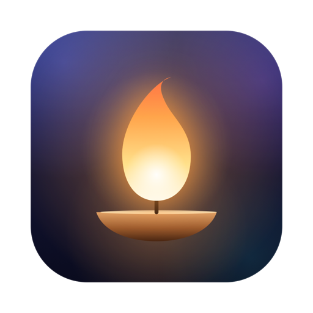

<p align="center">
  
</p>

<h1 align="center">Focus</h1>

<p align="center">一盏青灯。离开电脑去做题时，它替你守着屏幕。</p>

Focus 是一个原生 macOS 菜单栏 App，帮你在不需要电脑的学习时段（比如做题）远离电脑。离开电脑一段时间，或按下快捷键，整个屏幕会慢慢模糊下来，只留下一句励志的话和当前时间。模糊不会自己消失，想再用电脑，得先给自己一个理由。

## 下载安装

1. 到 [Releases](https://github.com/fancyecho/Focus/releases/latest) 下载 `Focus.dmg`
2. 打开 DMG，把 Focus 拖进“应用程序”文件夹
3. 第一次打开：这个 App 没有经过苹果公证，直接双击会被系统拦下。在“应用程序”里**右键点 Focus → 打开**，再点一次“打开”即可。
   如果提示“已损坏”，在终端运行下面这行再打开：
   ```bash
   xattr -dr com.apple.quarantine /Applications/Focus.app
   ```

需要 macOS 26 或更新版本。

装好之后就不用再来这里下载了：有新版本时，菜单栏的灯形图标右上角会出现一个小圆点，点开卡片按「更新」，会自动下载、替换并重启（2.2 及以后的版本支持）。

## 怎么用

- **开始专注**：按 `⌥⌘F`，或点菜单栏的灯形图标 →「开始专注」
- **自动触发**：离开电脑一段时间（默认 5 分钟，可在菜单里调）会自动模糊，离开的这段时间也算进专注
- **解除**，二选一：
  - 按住 `⌥⌘F` 约 4 秒，模糊会随进度慢慢揭开
  - 直接打字，输入「我现在要用电脑做正事」，打完自动解锁
- **时段**：点菜单卡片里的「时段」，设置每天固定时间暂停哪些 App。每个时段可以有多段时间、选星期、选时区；到点自动开始和结束。时段内打开被暂停的 App，会盖上一层拦截界面：
  - **温和**：按住按钮 3 秒可以再用 5 分钟，每天最多 3 次。屏幕顶部会出现一枚倒计时胶囊，最后 30 秒变红，鼠标移上去可以提前结束
  - **严格**：被暂停的 App 直接退出；进行中不能跳过，也不能修改、停用、删除这个时段，Focus 也不能从菜单退出
- **设置**：点菜单卡片底部的「设置」（或在时段窗口按 ⌘,）。离开后自动模糊、保持亮屏、音效、登录时启动、防止被强行退出都在这里
- **防止被强行退出**（设置里的开关，默认关闭）：交给系统的 launchd 守着，Focus 被活动监视器、强制退出、`killall` 结束后，几秒内会自动重开。第一次打开时，需要在「系统设置 › 通用 › 登录项」里允许

### 严格时段能拦住什么，拦不住什么

在一台你自己有管理员权限的 Mac 上，没有 App 能做到绝对拦住，Focus 的目标是让每一种绕过都必须刻意、费事。

能拦住的：
- 打开、切换到被暂停的 App，或者它原本就开在后台：严格模式会直接退出它
- 用 ⌘Tab 切走，想把它留在后面看：一样收起或退出
- 改系统时间、换时区：时段开始时会用不受改时间影响的单调时钟记下结束时刻
- 删掉配置文件：进行中的严格时段另存了一份快照
- 强行结束 Focus：打开「防止被强行退出」后会自动重开

拦不住的：
- 浏览器里的网页版（网页微信、B 站网页）
- 在「系统设置 › 登录项」里关掉 Focus 的后台权限，然后再结束它；或者直接删掉 Focus
- 换一个用户账户登录

如果需要更强的约束，可以配合 macOS 自带的「屏幕使用时间」，并把密码交给别人保管。

## 设计

- **不打扰**：8 秒不碰电脑就进入环境模式，按钮和光标隐去，只剩一句话和时钟；专注时长只在动鼠标、或鼠标停在时钟上时才出现，不让人去追数字
- **真正的渐变模糊**：模糊半径从 0 慢慢加深，保留壁纸原有的色彩；文字一层层从模糊中浮现
- **有手感的解锁**：长按或打字时，模糊随进度一点点揭开；打字时每打对一个字响一个五声音阶的音
- **安静的音效**：全部由代码合成（见 `scripts/make-sounds.swift`）；离开电脑自动触发时静音，可在菜单里关闭
- **小结**：解锁后显示本次专注时长、今日累计和连续天数；菜单栏卡片里有最近 7 天的柱状图
- **可以直接拖的时间轴**：拖两端改起止，拖中间整段平移，在空白处拖出新的一段；按 15 分钟吸附，碰到整点触控板会轻轻一震
- **时段与时区**：时间按所选时区的钟表时间生效；跨午夜的时段归前一天；夏令时切换时，拨快跳过的时刻顺延，拨回重复的那一小时整段算在内
- **拦截界面**：被暂停 App 的褪色图标外面有一圈“灯油”，时段还剩多少就亮多少；按回车或 Esc 回到学习，App 会被藏起来，切回你刚才在用的 App。从第二次起会轻轻提一句“这是今天第 N 次想打开它”
- **菜单栏的灯**：有时段在进行时，灯焰会点亮成实心
- **不熬电脑**：专注画面只在有人时保持亮屏，没人碰电脑超过设定时长（默认 1.5 小时）就按系统设置熄屏、睡眠；合盖时暂停计时；看视频、开会时不自动模糊

## 从源码构建

只需要 Xcode 命令行工具（不需要完整 Xcode）：

```bash
./build.sh            # 生成 build/Focus.app
./scripts/make-dmg.sh # 生成 build/Focus.dmg
```

开发时用 `scripts/dev-app.sh [启动参数]` 启动一个开发版：它的 bundle id 是 `com.helian.focus.dev`，设置和时段完全独立，随便写演示数据也不会碰到正在用的 Focus。

发布新版本：先把 `Info.plist` 里的版本号改大并提交，再运行

```bash
scripts/release.sh 更新说明.md
```

它会构建、打包 DMG、推送代码，并创建 `v<版本号>` 的 Release。App 里的自动更新读的就是这个 Release（附件必须叫 `Focus.dmg`）。

图标和音效分别由 `scripts/make-icon.swift`、`scripts/make-sounds.swift` 生成，结果已经放在 `Resources/` 里；删掉对应文件后再运行 `./build.sh` 会重新生成。
